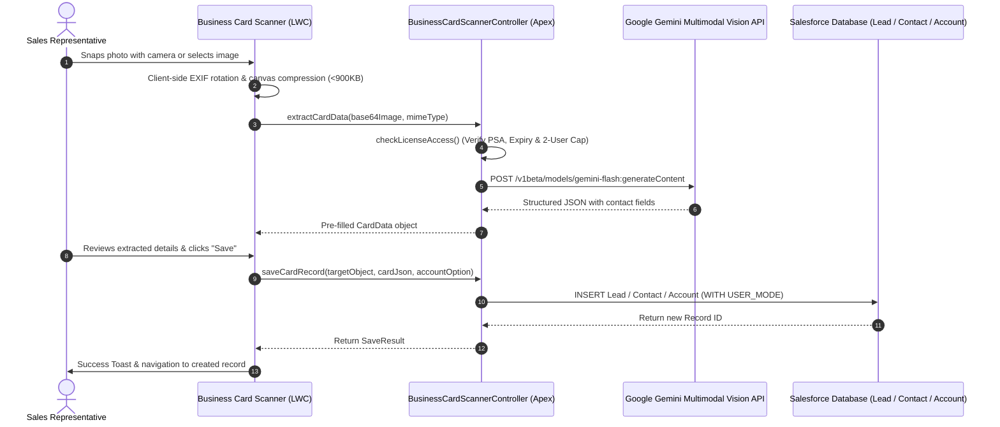

# 📇 AI-Powered Business Card Scanner for Salesforce

**Transform physical paper business cards into structured Salesforce Leads, Contacts, and Accounts in seconds using multimodal AI vision.**

[Key Features](#-key-features) • [Architecture](#-architecture--data-flow) • [Tech Stack](#-technology-stack) • [Quick Start](#-quick-start--installation) • [Licensing](#-licensing--commercial-inquiries)

 

---

## 📖 Overview

In modern B2B sales, conferences, and field networking, paper business cards remain a staple. However, manually typing contact information into Salesforce is tedious, error-prone, and delays lead follow-ups.

**AI-Powered Business Card Scanner** solves this problem by embedding a camera capture interface and Google Gemini AI Vision directly inside your Salesforce CRM (both desktop and Salesforce Mobile App). Sales reps simply snap a photo of any card, and in seconds, names, job titles, phone numbers, email addresses, websites, and physical addresses are automatically parsed, verified, and mapped directly into Salesforce CRM records.

---

## ✨ Key Features

### 1. 📸 Universal Camera & Gallery Capture
* **Native Phone Camera Integration:** Instant photo capture via desktop webcam, mobile camera (iOS/Android), or photo library upload.
* **Smart Orientation Normalization:** Automatically detects and corrects JPEG EXIF orientation on mobile uploads.
* **Adaptive Client-Side Compression:** High-resolution photos are pre-compressed in the browser before transfer, ensuring fast uploads even on mobile data.

### 2. 🧠 Multimodal AI Vision & Parsing (Google Gemini)
* **High-Accuracy Field Extraction:** Reads names, company names, titles, direct phone numbers, mobile numbers, emails, websites, and complete street addresses.
* **Layout Agnostic:** Handles multi-column layouts, artistic branding, vertical text, dark backgrounds, and non-standard typography.
* **Zero Client Exposure:** API keys and callouts are handled server-side in Apex—the API key is never exposed to the browser.

### 3. 🌐 Global Multilingual & Multi-Script OCR
* Natively extracts business cards in **over 100+ languages and character sets**:
  * **East Asian Scripts:** Japanese (Kanji, Hiragana, Katakana), Chinese (Simplified & Traditional), Korean (Hangul).
  * **European Languages:** Full support for accents, umlauts, and special characters (German, French, Spanish, Italian, etc.).
  * **Right-to-Left (RTL) Scripts:** Arabic and Hebrew cards.
  * **Indic Scripts:** Devanagari (Hindi) and regional languages.

### 4. ⚡ Direct 1-Click Salesforce Record Creation
* **Save as Lead:** Creates verified Lead records with standard company and contact field mapping.
* **Save as Contact:** Links the new contact to an existing Account via real-time Account autocomplete, or creates a new parent Account on the fly.
* **Save as Account:** Directly generates Business Account records.

 

### 5. 🔒 Enterprise Security & Anti-Loophole Protection
* **Server-Side Enforcement:** Strictly enforced server-side access control with `WITH USER_MODE` SOQL queries and sharing rules.
* **7-Day Automated Trial:** Evaluates automatically from the moment a user is assigned to the `Card Scanner Access` permission set.
* **Anti-Recycling Registry:** Limits the trial to **2 unique users across the organization's lifetime**, preventing license recycling loopholes while allowing seamless evaluation.

---

## 🏗️ Architecture & Data Flow

 

---

## 💻 Technology Stack

| Layer | Technologies Used | Description |
| :--- | :--- | :--- |
| **Frontend UI** | Lightning Web Components (LWC), SLDS, HTML5 Media Capture, Responsive SVG | Responsive mobile-first interface designed for Salesforce Lightning Experience & Mobile App |
| **Backend & Controller** | Salesforce Apex (API 61.0+), REST HTTP Callouts, JSON Serialization | Server-side image sanitization, Gemini API integration, and database operations |
| **AI Vision Engine** | Google Gemini Multimodal Vision API (1.5 Flash / 2.0 Flash) | Multimodal visual LLM for OCR, semantic entity extraction, and address categorization |
| **Data & Licensing** | Hierarchy Custom Settings (`Gemini_Settings__c`), Permission Sets (`Card_Scanner_Access`) | Granular access control, org defaults, user-level overrides, and anti-loophole tracking |
| **Security & Privacy** | Salesforce Shield Compatible, Apex `WITH USER_MODE`, Server-Side Key Vault | Zero client-side API key leakage, strict user permissions |

---

## 🚀 Quick Start & Installation

### Step 1: Install Package
Deploy or install the package in your Salesforce environment:

* **Production / Developer Edition:** [Install in Production](https://login.salesforce.com/packaging/installPackage.apexp?p0=04tg5000000HGgH) *(Use your package installation link)*
* **Sandbox:** [Install in Sandbox](https://login.salesforce.com/packaging/installPackage.apexp?p0=04tg5000000HGgH) *(Use your sandbox package installation link)*

---

### Step 2: Assign the Permission Set
1. In Salesforce Setup, search for **Permission Sets** in the Quick Find box.
2. Select **Card Scanner Access** (`Card_Scanner_Access`).
3. Click **Manage Assignments** $\rightarrow$ **Add Assignment**.
4. Select the users who should evaluate the scanner (up to **2 demo users** during trial mode) and click **Assign**.

---

### Step 3: Enter Your Gemini API Key
The scanner uses Google Gemini Vision API for high-speed, cost-effective extraction:
1. Generate an API key from [Google AI Studio](https://aistudio.google.com/app/apikey) (Free tier available).
2. Open the **Business Card Scanner** app or tab in Salesforce.
3. Click the **Settings Gear (⚙️)** in the top-right corner.
4. Paste your API key and click **Save Key**.

---

### Step 4: Scan Your First Business Card!
1. Click **Take Photo** (or upload from gallery).
2. The AI will extract the contact details within 2–3 seconds.
3. Choose whether to save as a **Lead**, **Contact**, or **Account**.
4. Click **Save**—the record is created immediately in Salesforce!

---

## 💼 Licensing & Commercial Inquiries

This solution comes with an automated **7-Day Free Trial** for up to **2 demo users per organization**:
* **Trial Period:** 7 days from the date each user is assigned the permission set.
* **Demo Cap:** Capped at 2 unique users per organization to evaluate functionality.
* **Full Version:** Unlocks unlimited team members, removes the 7-day expiration, and allows custom CRM object mappings.

### Ready to activate full licenses for your sales team?
Get in touch directly with our licensing and commercial partnership team:

 

 

| Contact Method | Details | Action |
| :--- | :--- | :--- |
| **📧 Direct Email** | `anjali.panchi@gmail.com` | [Send Email Inquiry](mailto:anjali.panchi@gmail.com?subject=Salesforce%20Business%20Card%20Scanner%20License%20Inquiry) |
| **📞 Phone / WhatsApp** | `+91 7289896549` | [Call or WhatsApp](tel:+917289896549) |

---

## 📋 Frequently Asked Questions (FAQ)

<b>Does it work with non-English business cards?</b>

Yes! Google Gemini Vision natively supports over 100+ languages and scripts, including Japanese (Kanji/Kana), Chinese, Arabic, Cyrillic, and European languages with accents and umlauts.

<b>Is the Google Gemini API key visible to end users?</b>

No. The API key is stored strictly server-side in Salesforce Custom Settings and is never sent to the client browser or mobile device.

<b>Can we customize field mappings to custom fields or objects?</b>

Yes. While the standard package maps to standard Lead, Contact, and Account fields, our team can provide custom configurations to map data directly into custom fields, custom objects, or CPQ. Contact us for custom implementations.

---

## 📄 License

Copyright © 2026. All rights reserved.  
This repository provides distribution, evaluation, and documentation materials. For commercial licensing, source code agreements, or enterprise rollout, please contact the licensing team.
